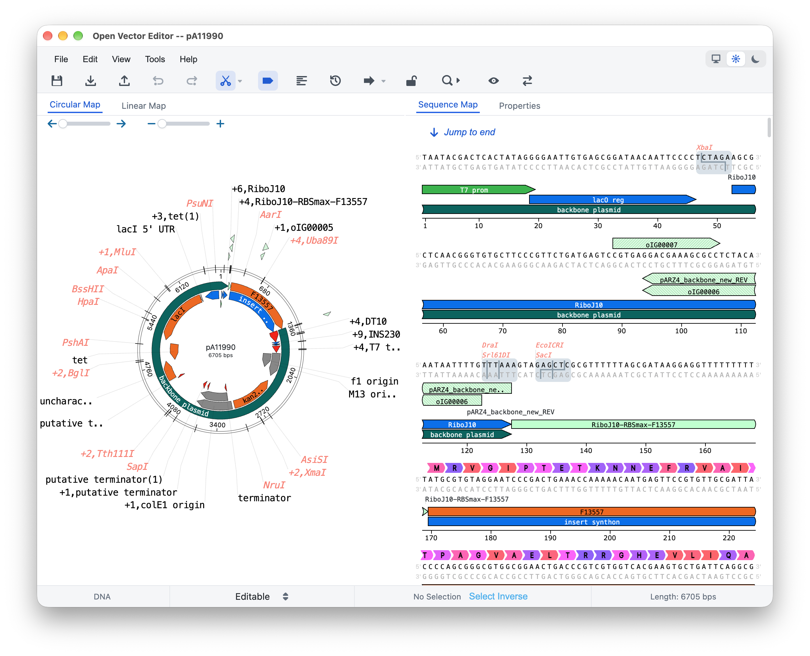

# Open Vector Editor Desktop

An independent cross-platform desktop application with a strict TypeScript application layer around [`@teselagen/ove@0.8.42`](https://github.com/TeselaGen/tg-oss/tree/main/packages/ove).

This repository is not a source fork or vendored copy of OVE. OVE is consumed only through the pinned npm dependency and isolated behind `EditorEngine`, so its implementation can be upgraded or replaced without coupling desktop services to OVE internals.

<picture>
  <source media="(prefers-color-scheme: dark)" srcset="docs/open-vector-editor-desktop-dark.png">
  
</picture>

## Releases

Installers are available from [GitHub Releases](https://github.com/zhaoshuoxp/OpenVectorEditor/releases):

| Platform | Packages |
| --- | --- |
| Windows x64 | NSIS installer and portable executable |
| macOS Intel and Apple Silicon | DMG and updater ZIP |
| Linux x64 and arm64 | AppImage and Debian package |

The Release workflow can be run manually to produce downloadable Actions artifacts without publishing. Pushing a version tag matching `package.json` (for example, `v2.2.0`) builds every platform, generates `SHA256SUMS.txt`, and publishes one GitHub Release containing the installers and auto-update metadata.

### Opening an unsigned macOS build

Release artifacts are unsigned unless the repository's Apple signing secrets are configured. If macOS blocks the application after you have downloaded it from this repository's GitHub Releases page and verified its checksum, move the application to `/Applications`, then remove its quarantine attribute:

```sh
xattr -dr com.apple.quarantine "/Applications/OpenVectorEditor.app"
```

Only run this command for an application whose source you trust. It recursively removes the Gatekeeper quarantine attribute from that application bundle.

## Architecture

- Electron 43 main process: windows, native menus, file associations, atomic save, updates and named IPC.
- Sandboxed preload: the renderer receives only the typed `DesktopApi`; arbitrary IPC channels are not exposed.
- React 18 renderer: desktop state, compatibility theme and local analysis panels.
- `EditorEngine`: the only application boundary allowed to read or update OVE editor state. `TeselagenOveAdapter` is the current implementation.
- Local tools: Primer3 2.6.1, BioMSA Worker alignment, version checkpoints and auto annotation.

Internal sequence coordinates are 0-based inclusive. Displayed vector and Primer Design coordinates are converted explicitly at the UI boundary.

## Requirements

- Node.js 22.12 or later (required by Electron 43 tooling)
- npm 10 or later recommended
- Platform packaging toolchains when building installers

OVE 0.8.42 declares historical peer ranges for several Blueprint-era dependencies. `.npmrc` enables legacy peer resolution so the React 18 version declared and tested by OVE itself remains pinned reproducibly.

## Development

```sh
npm ci
npm run dev
```

Useful checks:

```sh
npm run typecheck
npm test
npm run audit:ci
npm run validate-primer3
npm run build
npm run test:e2e
```

Linux E2E requires an X server; CI uses `xvfb-run`.

## Packaging

```sh
npm run package:win
npm run package:mac
npm run package:linux
```

Outputs are written to `release/`. Targets are Windows NSIS and portable x64, macOS DMG/updater ZIP x64 and arm64, and Linux AppImage/deb x64 and arm64.

For signed CI releases, configure `CSC_LINK`, `CSC_KEY_PASSWORD`, `APPLEID`, `APPLEIDPASS`, and `APPLETEAMID` as GitHub Actions secrets for macOS, and `WIN_CSC_LINK` plus `WIN_CSC_KEY_PASSWORD` for Windows. Without those secrets the workflow still produces unsigned packages. Auto-update metadata is generated by `electron-builder`, while the final GitHub Release is assembled by the GitHub CLI after all platform jobs succeed.

## Primer3

Primer3 2.6.1 binaries and thermodynamic configuration are under `bin/primer3/<platform>-<arch>`. `bin/primer3/SHA256SUMS` is enforced by the validation script. The GPLv2 license is copied beside every binary, and the corresponding 2.6.1 source is retained in `primer3-2.6.1/`. Build downloads and staging files are temporary `.cache/` content and are never committed.

To rebuild the current platform binary from that release source:

```sh
npm run prepare-primer3:source
```

## Compatibility acceptance

The E2E suite verifies native/editor menus, fixed toolbar order, tools and preference persistence. The legacy baseline contract is in `test/baseline/manifest.json`.

Approved platform screenshots live under `test/e2e/__screenshots__/<platform>/`. Run visual checks with `OVE_VISUAL_BASELINE=1`; screenshots use a maximum changed-pixel ratio of 0.005, with caret/toast instability masked. Golden images must be captured and reviewed separately on Windows, macOS and Linux before enabling that flag in release CI.

The production editor core is the pinned `@teselagen/ove@0.8.42` package.
